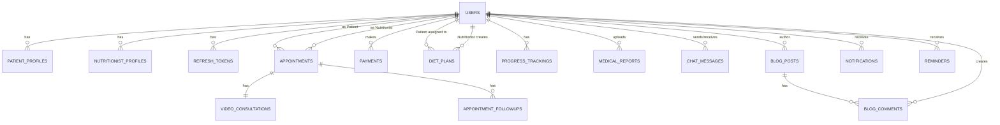

# NutriCare Pro - Database Design & Entity Relationship Diagram

## Database Overview

**Database Type:** SQL Server  
**ORM:** Entity Framework Core 9  
**Design Pattern:** Relational Model with Domain-Driven Design

---

## Core Entities

### 1. **User (Base Entity)**
Shared by all user types (Patient, Nutritionist, Admin)

```sql
CREATE TABLE Users (
    Id BIGINT PRIMARY KEY IDENTITY(1,1),
    Email NVARCHAR(256) NOT NULL UNIQUE,
    PasswordHash NVARCHAR(MAX) NOT NULL,
    FirstName NVARCHAR(100) NOT NULL,
    LastName NVARCHAR(100) NOT NULL,
    PhoneNumber NVARCHAR(20),
    ProfileImageUrl NVARCHAR(500),
    Role NVARCHAR(50) NOT NULL, -- Patient, Nutritionist, Admin
    IsActive BIT DEFAULT 1,
    CreatedAt DATETIME2 DEFAULT GETUTCDATE(),
    UpdatedAt DATETIME2,
    LastLoginAt DATETIME2,
    
    INDEX idx_email (Email),
    INDEX idx_role (Role)
);
```

### 2. **Patient Profile**
```sql
CREATE TABLE PatientProfiles (
    Id BIGINT PRIMARY KEY IDENTITY(1,1),
    UserId BIGINT NOT NULL UNIQUE,
    DateOfBirth DATE,
    Gender NVARCHAR(20), -- Male, Female, Other
    Height DECIMAL(5,2), -- in cm
    Weight DECIMAL(5,2), -- in kg
    BloodGroup NVARCHAR(10),
    MedicalHistory NVARCHAR(MAX),
    Allergies NVARCHAR(MAX),
    CurrentMedications NVARCHAR(MAX),
    EmergencyContact NVARCHAR(100),
    Address NVARCHAR(500),
    City NVARCHAR(100),
    State NVARCHAR(100),
    ZipCode NVARCHAR(20),
    CreatedAt DATETIME2 DEFAULT GETUTCDATE(),
    UpdatedAt DATETIME2,
    
    FOREIGN KEY (UserId) REFERENCES Users(Id) ON DELETE CASCADE
);
```

### 3. **Nutritionist Profile**
```sql
CREATE TABLE NutritionistProfiles (
    Id BIGINT PRIMARY KEY IDENTITY(1,1),
    UserId BIGINT NOT NULL UNIQUE,
    Qualification NVARCHAR(500),
    LicenseNumber NVARCHAR(100) UNIQUE,
    Specializations NVARCHAR(MAX), -- JSON array
    Experience INT, -- years
    ConsultationFee DECIMAL(10,2),
    IsVerified BIT DEFAULT 0,
    VerificationDate DATETIME2,
    Bio NVARCHAR(MAX),
    AvailableHours NVARCHAR(MAX), -- JSON
    MaxPatientsPerDay INT DEFAULT 10,
    CreatedAt DATETIME2 DEFAULT GETUTCDATE(),
    UpdatedAt DATETIME2,
    
    FOREIGN KEY (UserId) REFERENCES Users(Id) ON DELETE CASCADE,
    INDEX idx_verified (IsVerified)
);
```

### 4. **Appointment**
```sql
CREATE TABLE Appointments (
    Id BIGINT PRIMARY KEY IDENTITY(1,1),
    PatientId BIGINT NOT NULL,
    NutritionistId BIGINT NOT NULL,
    AppointmentDate DATETIME2 NOT NULL,
    Duration INT DEFAULT 30, -- minutes
    Status NVARCHAR(50) DEFAULT 'Scheduled', -- Scheduled, Completed, Cancelled, NoShow
    Type NVARCHAR(50), -- Initial, Follow-up, Video, In-person
    Notes NVARCHAR(MAX),
    CreatedAt DATETIME2 DEFAULT GETUTCDATE(),
    UpdatedAt DATETIME2,
    
    FOREIGN KEY (PatientId) REFERENCES Users(Id),
    FOREIGN KEY (NutritionistId) REFERENCES Users(Id),
    INDEX idx_date (AppointmentDate),
    INDEX idx_status (Status),
    INDEX idx_patient (PatientId),
    INDEX idx_nutritionist (NutritionistId)
);
```

### 5. **Payment**
```sql
CREATE TABLE Payments (
    Id BIGINT PRIMARY KEY IDENTITY(1,1),
    PatientId BIGINT NOT NULL,
    Amount DECIMAL(10,2) NOT NULL,
    Currency NVARCHAR(10) DEFAULT 'USD',
    PaymentMethod NVARCHAR(50), -- Stripe, JazzCash, EasyPaisa
    TransactionId NVARCHAR(255) UNIQUE,
    Status NVARCHAR(50), -- Pending, Completed, Failed, Refunded
    Description NVARCHAR(MAX),
    RelatedToId BIGINT, -- AppointmentId or DietPlanId
    RelatedToType NVARCHAR(50), -- Appointment, DietPlan, Service
    CreatedAt DATETIME2 DEFAULT GETUTCDATE(),
    UpdatedAt DATETIME2,
    
    FOREIGN KEY (PatientId) REFERENCES Users(Id),
    INDEX idx_status (Status),
    INDEX idx_date (CreatedAt),
    INDEX idx_transaction (TransactionId)
);
```

### 6. **Diet Plan**
```sql
CREATE TABLE DietPlans (
    Id BIGINT PRIMARY KEY IDENTITY(1,1),
    PatientId BIGINT NOT NULL,
    NutritionistId BIGINT NOT NULL,
    Title NVARCHAR(255) NOT NULL,
    Description NVARCHAR(MAX),
    Duration INT, -- days
    StartDate DATE,
    EndDate DATE,
    Objective NVARCHAR(MAX), -- Weight loss, muscle gain, etc.
    Meals NVARCHAR(MAX), -- JSON array of meals
    DailyCalories INT,
    Protein DECIMAL(5,2), -- grams
    Carbs DECIMAL(5,2), -- grams
    Fats DECIMAL(5,2), -- grams
    Status NVARCHAR(50) DEFAULT 'Active', -- Active, Archived, Completed
    CreatedAt DATETIME2 DEFAULT GETUTCDATE(),
    UpdatedAt DATETIME2,
    
    FOREIGN KEY (PatientId) REFERENCES Users(Id),
    FOREIGN KEY (NutritionistId) REFERENCES Users(Id),
    INDEX idx_patient (PatientId),
    INDEX idx_status (Status)
);
```

### 7. **Progress Tracking**
```sql
CREATE TABLE ProgressTrackings (
    Id BIGINT PRIMARY KEY IDENTITY(1,1),
    PatientId BIGINT NOT NULL,
    RecordDate DATE NOT NULL,
    Weight DECIMAL(5,2),
    Height DECIMAL(5,2),
    WaistCircumference DECIMAL(5,2),
    ChestCircumference DECIMAL(5,2),
    Notes NVARCHAR(MAX),
    EnergyLevel INT, -- 1-10 scale
    SleepQuality INT, -- 1-10 scale
    ExerciseMinutes INT,
    WaterIntake DECIMAL(4,2), -- liters
    CreatedAt DATETIME2 DEFAULT GETUTCDATE(),
    
    FOREIGN KEY (PatientId) REFERENCES Users(Id),
    INDEX idx_patient_date (PatientId, RecordDate)
);
```

### 8. **Medical Report**
```sql
CREATE TABLE MedicalReports (
    Id BIGINT PRIMARY KEY IDENTITY(1,1),
    PatientId BIGINT NOT NULL,
    ReportType NVARCHAR(100), -- Blood Test, X-ray, Scan, etc.
    FileUrl NVARCHAR(500), -- Azure Blob URL
    FileName NVARCHAR(255),
    FileSize BIGINT,
    UploadDate DATETIME2 DEFAULT GETUTCDATE(),
    ReportDate DATE,
    Description NVARCHAR(MAX),
    IsSharedWithNutritionist BIT DEFAULT 0,
    CreatedAt DATETIME2 DEFAULT GETUTCDATE(),
    
    FOREIGN KEY (PatientId) REFERENCES Users(Id),
    INDEX idx_patient (PatientId),
    INDEX idx_date (UploadDate)
);
```

### 9. **Chat Message**
```sql
CREATE TABLE ChatMessages (
    Id BIGINT PRIMARY KEY IDENTITY(1,1),
    SenderId BIGINT NOT NULL,
    ReceiverId BIGINT NOT NULL,
    Message NVARCHAR(MAX) NOT NULL,
    FileUrl NVARCHAR(500),
    IsRead BIT DEFAULT 0,
    ReadAt DATETIME2,
    CreatedAt DATETIME2 DEFAULT GETUTCDATE(),
    
    FOREIGN KEY (SenderId) REFERENCES Users(Id),
    FOREIGN KEY (ReceiverId) REFERENCES Users(Id),
    INDEX idx_receiver (ReceiverId),
    INDEX idx_created (CreatedAt)
);
```

### 10. **Video Consultation**
```sql
CREATE TABLE VideoConsultations (
    Id BIGINT PRIMARY KEY IDENTITY(1,1),
    AppointmentId BIGINT NOT NULL UNIQUE,
    RoomName NVARCHAR(255) NOT NULL UNIQUE,
    CallStartTime DATETIME2,
    CallEndTime DATETIME2,
    Duration INT, -- seconds
    RecordingUrl NVARCHAR(500), -- Azure Blob URL
    Status NVARCHAR(50), -- Scheduled, InProgress, Completed, Cancelled
    Notes NVARCHAR(MAX),
    CreatedAt DATETIME2 DEFAULT GETUTCDATE(),
    
    FOREIGN KEY (AppointmentId) REFERENCES Appointments(Id),
    INDEX idx_status (Status)
);
```

### 11. **Blog Post**
```sql
CREATE TABLE BlogPosts (
    Id BIGINT PRIMARY KEY IDENTITY(1,1),
    AuthorId BIGINT NOT NULL,
    Title NVARCHAR(500) NOT NULL,
    Slug NVARCHAR(500) NOT NULL UNIQUE,
    Content NVARCHAR(MAX),
    FeaturedImageUrl NVARCHAR(500),
    Category NVARCHAR(100),
    Tags NVARCHAR(MAX), -- JSON array
    Status NVARCHAR(50) DEFAULT 'Draft', -- Draft, Published, Archived
    ViewCount INT DEFAULT 0,
    PublishedDate DATETIME2,
    CreatedAt DATETIME2 DEFAULT GETUTCDATE(),
    UpdatedAt DATETIME2,
    
    FOREIGN KEY (AuthorId) REFERENCES Users(Id),
    INDEX idx_status (Status),
    INDEX idx_published_date (PublishedDate),
    INDEX idx_slug (Slug)
);
```

### 12. **Blog Comment**
```sql
CREATE TABLE BlogComments (
    Id BIGINT PRIMARY KEY IDENTITY(1,1),
    BlogPostId BIGINT NOT NULL,
    UserId BIGINT NOT NULL,
    Comment NVARCHAR(MAX),
    Likes INT DEFAULT 0,
    Status NVARCHAR(50) DEFAULT 'Pending', -- Pending, Approved, Rejected
    CreatedAt DATETIME2 DEFAULT GETUTCDATE(),
    
    FOREIGN KEY (BlogPostId) REFERENCES BlogPosts(Id) ON DELETE CASCADE,
    FOREIGN KEY (UserId) REFERENCES Users(Id),
    INDEX idx_blog (BlogPostId),
    INDEX idx_status (Status)
);
```

### 13. **Notification**
```sql
CREATE TABLE Notifications (
    Id BIGINT PRIMARY KEY IDENTITY(1,1),
    UserId BIGINT NOT NULL,
    Type NVARCHAR(50), -- Appointment, Message, Payment, System
    Title NVARCHAR(255),
    Message NVARCHAR(MAX),
    RelatedToId BIGINT,
    RelatedToType NVARCHAR(50),
    IsRead BIT DEFAULT 0,
    ReadAt DATETIME2,
    CreatedAt DATETIME2 DEFAULT GETUTCDATE(),
    
    FOREIGN KEY (UserId) REFERENCES Users(Id),
    INDEX idx_user (UserId),
    INDEX idx_created (CreatedAt),
    INDEX idx_read (IsRead)
);
```

### 14. **Reminder**
```sql
CREATE TABLE Reminders (
    Id BIGINT PRIMARY KEY IDENTITY(1,1),
    UserId BIGINT NOT NULL,
    Type NVARCHAR(50), -- Appointment, DietPlan, Medication, Exercise
    Title NVARCHAR(255),
    Description NVARCHAR(MAX),
    ScheduledTime DATETIME2 NOT NULL,
    IsActive BIT DEFAULT 1,
    NotificationChannels NVARCHAR(50), -- Email, SMS, Push
    CreatedAt DATETIME2 DEFAULT GETUTCDATE(),
    
    FOREIGN KEY (UserId) REFERENCES Users(Id),
    INDEX idx_user_active (UserId, IsActive),
    INDEX idx_scheduled_time (ScheduledTime)
);
```

### 15. **Appointment Follow-up**
```sql
CREATE TABLE AppointmentFollowUps (
    Id BIGINT PRIMARY KEY IDENTITY(1,1),
    AppointmentId BIGINT NOT NULL,
    FollowUpDate DATE,
    Status NVARCHAR(50) DEFAULT 'Scheduled',
    Notes NVARCHAR(MAX),
    CreatedAt DATETIME2 DEFAULT GETUTCDATE(),
    
    FOREIGN KEY (AppointmentId) REFERENCES Appointments(Id)
);
```

### 16. **RefreshToken**
```sql
CREATE TABLE RefreshTokens (
    Id BIGINT PRIMARY KEY IDENTITY(1,1),
    UserId BIGINT NOT NULL,
    Token NVARCHAR(MAX) NOT NULL,
    ExpiryDate DATETIME2 NOT NULL,
    IsRevoked BIT DEFAULT 0,
    RevokedAt DATETIME2,
    CreatedAt DATETIME2 DEFAULT GETUTCDATE(),
    
    FOREIGN KEY (UserId) REFERENCES Users(Id) ON DELETE CASCADE,
    INDEX idx_user (UserId),
    INDEX idx_expiry (ExpiryDate)
);
```

---

## Entity Relationship Diagram (ERD)



---

## Key Relationships

| From | To | Cardinality | Description |
|------|-----|-------------|-------------|
| User | PatientProfile | 1:1 | Each patient has one profile |
| User | NutritionistProfile | 1:1 | Each nutritionist has one profile |
| User | Appointment | 1:N | Patient/Nutritionist can have multiple appointments |
| Appointment | VideoConsultation | 1:1 | Each appointment can have one video consultation |
| Patient | DietPlan | 1:N | A patient can have multiple diet plans |
| Nutritionist | DietPlan | 1:N | A nutritionist can create multiple diet plans |
| Patient | ProgressTracking | 1:N | Track multiple progress records |
| Patient | MedicalReport | 1:N | Multiple medical reports per patient |
| User | ChatMessage | 1:N | Users can send/receive multiple messages |
| User | BlogPost | 1:N | Nutritionist can create multiple posts |
| BlogPost | BlogComment | 1:N | Multiple comments per post |
| User | Notification | 1:N | User receives multiple notifications |
| User | Reminder | 1:N | Multiple reminders per user |
| User | Payment | 1:N | Multiple payments per user |

---

## Indexes for Performance

```sql
-- Critical Indexes
CREATE INDEX idx_user_email ON Users(Email);
CREATE INDEX idx_appointment_patient ON Appointments(PatientId, AppointmentDate);
CREATE INDEX idx_appointment_nutritionist ON Appointments(NutritionistId, AppointmentDate);
CREATE INDEX idx_payment_status ON Payments(Status, CreatedAt);
CREATE INDEX idx_diet_plan_patient ON DietPlans(PatientId, Status);
CREATE INDEX idx_progress_patient_date ON ProgressTrackings(PatientId, RecordDate);
CREATE INDEX idx_chat_receiver ON ChatMessages(ReceiverId, IsRead, CreatedAt);
CREATE INDEX idx_notification_user ON Notifications(UserId, IsRead, CreatedAt);
CREATE INDEX idx_blog_published ON BlogPosts(Status, PublishedDate);
```

---

## Constraints & Rules

1. **Unique Constraints:**
   - Email must be unique per user
   - License number must be unique per nutritionist
   - Transaction ID must be unique for payments
   - Blog post slug must be unique

2. **Data Integrity:**
   - Foreign key constraints on all relationships
   - Cascade delete for user-related data
   - Check constraints for statuses

3. **Business Rules:**
   - Appointment duration minimum 15 minutes
   - Nutritionist verification required before consultation
   - Payment status must be validated
   - Medical report uploads limited by file size

---

## Database Seeding

### Initial Data to Seed:
- Admin user account
- Sample nutritionists (verified)
- Sample patients
- Sample diet plans
- Sample blog posts
- Configuration data

---

## Migration Strategy

1. **Initial Migration:** Create all tables and relationships
2. **Incremental Migrations:** One migration per change
3. **Version Control:** All migrations tracked in Git
4. **Rollback Plan:** Preserve previous schema versions
5. **Data Preservation:** Ensure data migration on schema changes

---

## Backup & Recovery

- Daily backups to Azure Backup
- Point-in-time recovery enabled
- Automated backup retention: 35 days
- Test recovery procedures monthly
