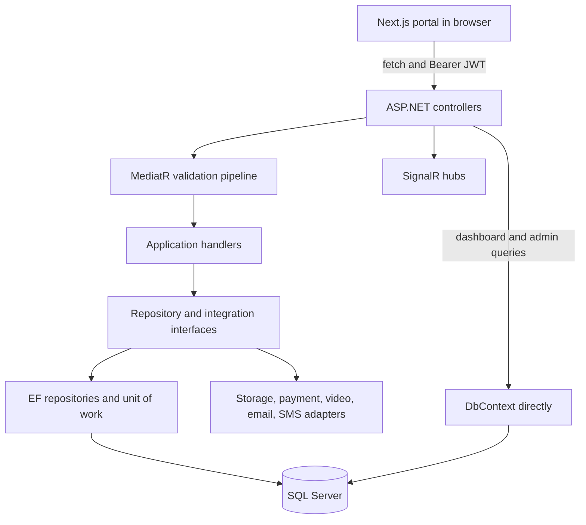

# NutriCare Pro: engineering map and implementation review

Reviewed: 14 October 2026. This document describes the source in this workspace, with build results recorded below. Earlier planning documents describe a broader intended product and sometimes differ from the implementation.

## 1. Product and current state

NutriCare Pro connects patients with nutritionists. Its intended care cycle is account creation, profile setup, appointment booking, payment, consultation, diet-plan assignment, and ongoing progress tracking. Medical reports, messages, notifications, educational articles, and administrative controls support that cycle.

The three platform roles are Patient, Nutritionist, and Admin. User IDs and patient/nutritionist profile IDs are different identifiers. Most clinical endpoints resolve a profile from the authenticated user's `uid` claim before accessing records.

The workspace contains a substantial backend implementation and a smaller portal implementation. It is not yet a complete, verified production application. Backend compilation, account onboarding, data access, authorization, and deployment configuration need attention before an end-to-end release can be established.

Inventory from source:

- Five .NET projects in one solution.
- Fourteen controller classes across twelve controller files.
- Ninety-four HTTP action declarations, including seven placeholder patient/nutritionist actions.
- Nineteen domain entities, plus the supporting ASP.NET Identity join/claim/login/token tables.
- Six public website pages and four portal pages.
- Two SignalR hubs.
- One older initial SQL script and ten SQL scripts alongside the active backend.
- No executable unit, integration, or end-to-end test suites found in the project source.

## 2. Where the executable code lives

| Path | Responsibility |
| --- | --- |
| `src/backend/NutriCare.sln` | Active backend solution. |
| `src/backend/NutriCare.API/` | Startup, controllers, middleware, health checks, Swagger, SignalR. |
| `src/backend/NutriCare.Application/` | Commands, queries, handlers, DTOs, validation, mapping. |
| `src/backend/NutriCare.Domain/` | Entities, interfaces, enums, exceptions, base domain-event types. |
| `src/backend/NutriCare.Infrastructure/` | Tokens, email, SMS, blob storage, payments, meeting providers. |
| `src/backend/NutriCare.Persistence/` | Identity DbContext, EF mappings, repositories, unit of work, SQL scripts. |
| `backend/NutriCare.Persistence/Migrations/001_CreateInitialSchema.sql` | Earlier standalone database design; not a second executable backend. |
| `frontend/nutricare-pro-portal/` | Active Next.js application. |
| `docs/` | Planning, schema reference, notification design, production setup, and this review. |
| `infra/azure/main.bicep` | Azure resource template. |
| `.github/workflows/ci-cd.yml` | Builds, image publishing, and Container Apps deployment. |
| `docker-compose.yml` | Local SQL Server, API, and portal containers. |
| `deployment/` | Empty directory in the inspected snapshot. |

The root README still describes Phase 1 and refers to `NutriCare.Core`; the active project is named `NutriCare.Domain`. Its proposed frontend libraries and API version prefix also differ from the source.

## 3. Actual technology stack

| Area | Implementation |
| --- | --- |
| API | ASP.NET Core targeting `net9.0`, C#. |
| Persistence | Entity Framework Core 9, SQL Server, ASP.NET Identity with `long` keys. |
| Application dispatch | MediatR commands/queries and handlers. |
| Validation | FluentValidation through a MediatR pipeline behavior. |
| Mapping | AutoMapper registration and profile; many handlers use manual mapping. |
| Authentication | Identity password verification, signed JWT access tokens, hashed rotating refresh tokens. |
| Realtime | SignalR chat and notification hubs, process-local presence tracking. |
| Frontend | Next.js 15.0.3, React 18.2, TypeScript; versions from `package.json`. |
| Styling and icons | Custom `globals.css`, inline chart styling, Lucide React. |
| Browser state and HTTP | React hooks, browser local storage, native `fetch`. |
| File storage | Azure Blob Storage with private containers. |
| Messaging providers | SendGrid and Twilio. |
| Payment integrations | Stripe HTTP calls and configurable JazzCash/EasyPaisa HTTP adapters. |
| Video integrations | Google Meet and Zoom HTTP adapters; opens external meeting links. |
| Operations | Serilog, health checks, rate limiting, output caching, Docker, GitHub Actions, Azure Container Apps. |

Tailwind, Shadcn, Redux, Zustand, Axios, and a browser SignalR client are not present in the frontend package manifest. They appear in earlier plans.

## 4. Architecture and request flow

This is a layered monolith with one shared database. Commands and queries are separated in code, but there are no separate read/write databases, independently deployed clinical services, or event bus.

Project-reference direction is API -> Persistence/Infrastructure -> Application -> Domain. The separation is incomplete: Domain has Identity and other package dependencies; dashboards and admin endpoints contain direct EF queries; several large files contain multiple related classes. Most business rules live in application handlers rather than entity methods. Domain-event base types exist, but no dispatch mechanism was found.

`Program.cs` builds the request pipeline in this order:

1. Global exception handling, security headers, request logging.
2. Development-only Swagger, then HTTPS redirection.
3. CORS, rate limiter, output cache.
4. Authentication, authorization, audit logging.
5. Controllers, health checks, chat hub, notification hub.

Startup calls `EnsureCreatedAsync()` against SQL Server before the API begins serving. It does not run the SQL script directory or apply tracked EF migrations.

Successful JSON responses generally use `ApiResponse<T>` with `success`, `message`, `data`, `errors`, and `statusCode`. File downloads return file responses. JWT authentication failures use a separate `{ error: ... }` shape. Some auth actions catch exceptions themselves, so error handling is not fully uniform.

## 5. Data model

The canonical current entity definitions are `src/backend/NutriCare.Domain/Entities/DomainEntities.cs`; mappings are in `NutriCareDbContext.cs`.

| Group | Entities and ownership |
| --- | --- |
| Identity | `User`, `Role`, and Identity support tables. A user can have a Patient and/or Nutritionist profile. |
| Patient | `Patient`: demographics, body metrics, medical context, contact and preferences. |
| Clinician | `Nutritionist`: license, verification, fee, consultation duration, availability metadata, ratings. |
| Scheduling | `Appointment`: patient/nutritionist relationship, time, status, notes, approval/rejection/cancellation/completion metadata. |
| Nutrition | `DietPlan` -> `DietPlanItem`; `DietPlanCompliance` tracks daily meals, water, supplements, and adherence. |
| Progress | `WeightTracking`: dated weight, BMI, body metrics, hydration, calories, and activity. |
| Documents | `MedicalReport`: patient ownership, private blob coordinates, metadata, review notes. |
| Billing | `Invoice` -> `Payment` -> `PaymentRefund`; patient and optional nutritionist links. |
| Consultations | `VideoConsultation`: one per appointment, provider links, schedule, timestamps, recording metadata. |
| Communication | `Message`: sender/receiver user IDs, deterministic conversation ID, attachments, delivery/read metadata. |
| Alerts | `Notification`: user, channel, event, related record, read/delivery status. |
| Publishing | `Blog`: author, slug, content, category/tags, draft/published status. |
| Feedback | `Review`: patient/nutritionist ratings; the entity exists, but review endpoints are placeholders. |
| Operations | `AuditLog`: request/user/action metadata and result. |

`BaseEntity` provides `Id`, UTC timestamps, nullable `DeletedAt`, and a computed C# `IsDeleted` getter. Users and roles implement similar timestamp/deletion fields outside BaseEntity. There is no global soft-delete query filter, and generic `DeleteAsync` physically removes records.

Important configured indexes include unique email, nutritionist license, transaction ID, invoice number, blog slug, one video consultation per appointment, one weight record per patient/date, and one compliance record per plan/date. Several additional indexes exist only in the SQL scripts. Decimal precision and SQL constraints are not comprehensively mirrored in the EF mappings.

The old initial SQL design uses names such as `UserId`, `PatientId`, `RoleId`, and verification flags that differ from the current Identity model and EF `Id` keys. It should not be treated as interchangeable with the runtime schema.

## 6. Business workflows and their boundaries

### Authentication and onboarding

Registration validates input, creates an Identity user, assigns the requested role, generates an email confirmation token, and invokes email delivery. Login requires an active, nondeleted user with confirmed email. It issues a configurable short-lived access token and a random refresh token; only the SHA-256 refresh-token hash is stored on the user. The handlers use a seven-day refresh expiry. Refresh rotates the single stored token. Logout clears it; password reset also clears it.

Account verification, resend, password reset, and admin role changes have API actions. The reset email links to a POST-only API reset action; there is no browser reset form. `VerifyTokenQuery` is dispatched by `/api/Auth/verify`, but no handler was found. Two other authentication queries are declared without handlers and currently have no calling controller action.

Registration does not create a Patient or Nutritionist profile, and no implemented profile-creation endpoint was found. Role assignment alone does not provision a clinical profile. Most clinical paths therefore require records created outside the current onboarding flow.

### Appointments

Patient booking resolves the caller's profile, loads the nutritionist, checks for overlapping appointments, and inserts a `Pending` appointment using the nutritionist's configured duration. Booking then invokes notifications for both parties.

The implemented lifecycle uses `Pending`, `Approved`, `Rejected`, `InProgress`, `Completed`, and `Cancelled`; some older `Scheduled` values are also recognized. Nutritionists can approve/reject their own appointments, save consultation notes, and complete approved/in-progress appointments. Patients can reschedule their own appointments. Cancellation checks the caller's relationship to the appointment.

The available-slot query steps through the requested range and removes exact booked start times. It does not implement availability calendars, opening hours, timezone conversion, or full interval overlap filtering. The booking conflict check handles overlaps but is a query followed by insertion without an explicit serialization mechanism. Concurrent bookings need a meaningful database integration test. `IsVerified` and daily capacity are not checked during booking. Rescheduling changes the existing row and sets `RescheduledFromId` to its own ID; it is not a separate historical version.

### Diet plans

Nutritionists create plans containing calories/macros, dates, instructions, water targets, and meal items. Updating checks plan ownership, replaces meal items, and increments a version number. Patient compliance is upserted per plan/date, with a calculated meal-completion percentage. Individual plan reads and downloads check caller ownership. Patient-list reads have weaker relationship checks, described below.

PDF output is a custom single-page ASCII PDF renderer. It takes only the first 40 lines, so large plans lose content and non-ASCII text is not preserved.

### Progress

Patients upsert one daily record containing weight and optional metrics. BMI is calculated from height if omitted. The handler updates `Patient.CurrentWeight` whenever any dated record is written, so adding a historical measurement can overwrite the profile's current weight. History, metric chart points, and aggregate analytics have API queries. The portal shows progress but has no logging form.

### Medical reports

Patient uploads accept PDF/JPEG/PNG/WebP, enforce size/type/extension rules, and check file signatures. Bytes go to a private Azure container with generated names; SQL stores metadata. Downloads pass through the API after access checks. Nutritionist report access checks for either an appointment or diet-plan relationship. The policy should define which historical relationships remain sufficient and what clinical access an administrator may have. Nutritionists/admins can add review notes. This corrects the earlier review's mistaken statement that the appointment repository was unused; see `MedicalReportHandlers.cs:301`.

Blob upload precedes SQL persistence without cleanup on failure, so failed database work can leave orphaned files. Storage connection settings must be supplied; constructing the client with the checked-in empty connection setting cannot provide working storage.

### Payments

A patient initiates payment using an amount, currency, provider, optional related record, and return URLs. The handler creates an invoice and initializes checkout. Provider callbacks find a payment by transaction/provider ID, update its status, and mark an invoice paid on completion. Admins can request refunds. Payment/invoice reads have patient ownership checks.

The amount is supplied by the client; it is not derived from an appointment or the nutritionist fee. Wallet adapters use a generic configurable request contract. Provider acceptance, currency handling, reconciliation, and settlement were not exercised. Refund accounting advances after the provider response without waiting for a successful final settlement status. Stripe checkout-session IDs are stored in the same field later passed as `payment_intent` for refunds, which needs correction/verification before live use.

### Chat and presence

Messages are stored in SQL; conversation IDs sort the two user IDs as `smaller:larger`. Sending requires a patient/nutritionist relationship established by an appointment or diet plan. History, unread counts, read receipts, and participant-only attachment download have API paths. REST sends persist messages, broadcast SignalR events, and dispatch notification events. Direct hub sends persist and broadcast but do not invoke the same notification service.

Attachment uploads enforce size and declared MIME type, with less validation than medical reports. Upload happens before relationship authorization in the handler, which can leave files for rejected sends. Presence is an in-memory singleton, so it covers one API process. No distributed backplane was found.

### Video

Nutritionists/admins schedule a provider meeting for an appointment; participants can obtain details and join. The first join records start time and marks the consultation in progress. Completion records end time/duration and optional recording URL. Recording storage is metadata only; no recording capture pipeline exists. Rescheduling an appointment does not update an existing provider meeting.

Provider tokens are static configuration inputs, with no OAuth refresh lifecycle implemented. Missing provider credentials produce simulated example-domain meeting links. The portal opens an external meeting tab; it does not embed video or implement WebRTC.

### Notifications

Events cover booking, reminders, plan assignment, payment receipt, and REST chat messages. Channel configuration selects InApp/Email/SMS. In-app entries persist in SQL; email uses SendGrid; SMS uses Twilio. Dispatch occurs synchronously after business operations. Missing email/SMS credentials log a simulated delivery and return success. No delivery queue, automatic retry, outbox, or scheduled reminder worker was found. Reminders currently require a manual API call.

Notification hub methods exist separately from the notification dispatcher. Persisting an in-app notification does not automatically publish it to the notification hub.

### Dashboards and publishing

The patient dashboard returns upcoming appointments, active plan/compliance, recent weight measurements, reports, notifications, and messages. Some summary counts are counts of limited result sets, rather than total matching records.

The nutritionist dashboard returns today's/pending appointments, patients derived from appointment relationships, patient progress, revenue, and messages. Patients with only a diet-plan relationship are not included in its active-patient list.

Admin APIs provide totals, revenue and appointment analytics, user activation, nutritionist verification, patient/nutritionist listings, blog CRUD, and audit listings. Several filters/pagination operations occur after loading full lists into memory. Revenue queries do not consistently account for partially/fully refunded payments, and currencies are aggregated together. The UI formats revenue in USD.

Blog CRUD is restricted to Admin in the current API. The public blog page uses hardcoded posts and is not connected to stored published blogs. Public article detail/comment routes are absent.

## 7. Frontend map

| Route | Actual behavior |
| --- | --- |
| `/` | Static marketing home page and consultation calls to action. |
| `/about` | Static product/service story. |
| `/services` | Static service descriptions. |
| `/testimonials` | Static testimonial content. |
| `/blogs` | Hardcoded article summaries. |
| `/contact` | Displayed inquiry form; its button has no submission handler. |
| `/patient` | API-backed dashboard display and manual token entry. |
| `/nutritionist` | API-backed practice dashboard display and manual token entry. |
| `/admin` | API-backed overview, people controls, blog CRUD, audit display. |
| `/video-consultations` | Token entry, schedule by appointment ID, history, join, complete. |

The four service files correspond to patient dashboard, nutritionist dashboard, admin dashboard, and video consultation API calls. Related TypeScript contracts are in `src/types/`. Pages use local `useState`/`useEffect`; no central session store exists. The admin page loads eight resources concurrently, and a failure in any one prevents the combined update.

JWTs are entered manually and kept as `localStorage.accessToken`. There are no login, registration, profile onboarding, token-refresh, password-reset, appointment booking, checkout, diet-plan editor, progress entry, report upload, or chat-conversation screens. The patient/nutritionist dashboards mostly display data rather than providing those actions. Video controls are not tailored to the caller's role even though the API restricts scheduling/completion.

Public pages have metadata, canonical URLs, Open Graph/Twitter metadata, JSON-LD, a sitemap, robots rules, and a generated Open Graph image. Portal layouts request no indexing. This affects search visibility; API authorization remains the access boundary. Responsiveness is implemented with custom CSS and media queries. No PWA manifest/service worker was found.

## 8. API catalog

Paths are under `/api`, without the `/v1` prefix in the original plans. Controller route casing below follows declarations; normal ASP.NET routing accepts case-insensitive matches. `{id:long}` indicates an integer route constraint. Counts include placeholders.

| Base path | Actions |
| --- | --- |
| `/api/Auth` (12) | POST `login`, `register`, `logout`, `forgot-password`, `reset-password`, `resend-verification`, `refresh-token`, `verify`; GET `verify-email`, `{id}`; PUT/DELETE `users/{userId}/role`. |
| `/api/Patients` (3) | GET/PUT `{id}`; GET `{id}/weight-history`. All three are placeholders. |
| `/api/Nutritionists` (4) | GET base, `{id}`, `{id}/available-slots`, `{id}/reviews`. All four are placeholders. |
| `/api/Appointments` (13) | POST base; PUT `{id}/reschedule`, `{id}/approve`, `{id}/reject`, `{id}/complete`, `{id}/consultation-notes`; DELETE `{id}/cancel`; GET base, `{id}`, `history`, `patient/{patientId}`, `nutritionist`, `available-slots`. |
| `/api/DietPlans` (9) | POST base; PUT `{id}`; GET `{id}`, `my-plans`, `patient/{patientId}`, `nutritionist`, `{id}/download`; POST/GET `{id}/compliance`. |
| `/api/Progress` (7) | POST base; GET `history`, `charts`, `analytics`, `patient/{patientId}/history`, `patient/{patientId}/charts`, `patient/{patientId}/analytics`. |
| `/api/MedicalReports` (6) | POST base; GET `my-reports`, `patient/{patientId}`, `{id}`, `{id}/download`; PUT `{id}/notes`. |
| `/api/Payments` (8) | POST `process`, `{id}/refund`, `webhooks/{provider}`; GET base, `history`, `patient/{patientId}`, `{id}`, `{id}/invoice`. |
| `/api/Chat` (6) | POST `messages`, `messages/file`; GET `history/{otherUserId}`, `unread`, `messages/{messageId}/attachment`; PUT `conversations/{otherUserId}/read`. |
| `/api/VideoConsultations` (6) | POST `schedule`, `{id}/join`; PUT `{id}/complete`; GET `{id}`, `appointment/{appointmentId}`, `history`. |
| `/api/Notifications` (5) | GET base, `unread-count`; PUT `{id}/read`, `read-all`; POST `appointment-reminders`. |
| `/api/patient-dashboard` (1) | GET base, Patient role. |
| `/api/nutritionist-dashboard` (1) | GET base, Nutritionist role. |
| `/api/admin` (13) | GET `summary`, `analytics/revenue`, `analytics/appointments`, `users`, `patients`, `nutritionists`, `blogs`, `audit-logs`; PUT `users/{id}/status`, `nutritionists/{id}/verification`; POST `blogs`; PUT/DELETE `blogs/{id}`. |

Additional mapped endpoints: `GET /api/health`, `/hubs/chat`, `/hubs/notifications`. Swagger UI is mounted at `/` in Development; its OpenAPI document is `/swagger/v1/swagger.json`.

## 9. Findings that affect correctness or release readiness

These are source observations unless explicitly identified as build results. Database-backed failure behavior and exploitability were not exercised against a running API.

| Priority | Finding | Evidence and implication |
| --- | --- | --- |
| Critical | Public registration accepts Admin. | `AuthController.Register` is anonymous; `RegisterCommandValidator` accepts Admin; `RegisterCommandHandler` assigns the supplied role. Email confirmation does not provide admin approval. |
| Critical | Payment callback signatures are optional. | `PaymentGatewayService.ParseStripeWebhook` and `ParseWalletWebhook` validate only when both secret and signature are nonempty. Omitting a header skips verification even with a configured secret. The anonymous callback handler can update stored payment status. |
| High | Several record reads lack relationship authorization. | `GetAppointmentByIdQueryHandler` reads any requested appointment; the controller allows Patient/Nutritionist/Admin without ownership checking. Nutritionist reads of patient appointment lists, progress, and diet-plan lists also lack an assigned-patient check. |
| High | SignalR methods trust caller-selected destinations. | `ChatHub.JoinAppointmentGroup` does not verify participation. Group sending and notification methods accept arbitrary destinations. NotificationHub's notification-producing methods are callable by any authenticated hub client. |
| High | Meeting host links are included in ordinary DTOs. | `VideoConsultationHelpers.ToDto` returns `HostUrl` for detail/history responses available to patients. The join-specific response hides it for nonhosts, but the other responses bypass that restriction. |
| High | Backend build fails. | Local `dotnet build --no-restore` produced NU1605 errors for SignalR and IdentityModel.Tokens. AutoMapper has a separate incompatible-version warning. |
| High | Profile onboarding is absent. | Registration only persists a User and role. Patient/Nutritionist profile handlers are placeholders or absent. Clinical endpoints require those profiles. |
| High | Soft-delete SQL expressions are likely untranslatable. | Many EF predicates reference the get-only C# `IsDeleted` property. No mapped/computed column or query translation is configured. Use mapped `DeletedAt` predicates or an intentional model/query-filter design, then reproduce against SQL Server. |
| High | Schema creation is not schema migration. | Startup uses `EnsureCreatedAsync`; existing schemas are not upgraded. SQL scripts are not automatically executed, and the old standalone schema differs from the Identity model. |
| High | Container frontend configuration is supplied too late. | The portal Dockerfile runs `next build` without the public API/site build variables. Compose/Bicep supply `NEXT_PUBLIC_*` at container runtime, while browser bundles use values embedded during build. The client fallback is `https://localhost:7001`. |
| High | Deployment wiring is incomplete. | Bicep creates storage without wiring its connection into the API, does not supply the deployed portal's CORS origin, and contains no SQL network-access rule/private-network setup. Live deployment was not attempted. |
| Medium | Missing provider configuration can appear successful. | Payment/video adapters silently simulate; email/SMS log and return success. These paths have no production-only fail-closed requirement. |
| Medium | Payment integrity and retries need stronger rules. | Client-chosen amount, no webhook event deduplication/provider-match enforcement, no monotonic settlement state machine, and premature refund accounting. Repeat callbacks can also repeat notifications. |
| Medium | Account lockout settings are not enforced by login. | Login uses `UserManager.CheckPasswordAsync` without SignInManager lockout checks or failed-attempt bookkeeping. Existing access tokens also outlive logout/deactivation/role changes until expiry. |
| Medium | User-oriented rate partitioning runs before authentication. | The limiter reads `uid` before `UseAuthentication`, so normal JWT requests are generally partitioned by IP. Proxy forwarding configuration is also absent. |
| Medium | Logging and error handling have gaps. | Several auth actions return raw exception messages. Missing-provider email logging includes verification/reset links. Validation errors are collected but the global handler does not copy field errors into the response. |
| Medium | Audit capture is limited and shares the business DbContext. | It records mutating requests with `EntityId=0`, rather than entity history. Its finally-block SaveChanges can interact with tracked changes after failed business operations. |
| Medium | Scheduling and finance summaries can mislead. | Availability omits business hours/timezones; booking is not serialized. Revenue excludes refunded-status payments while also subtracting refunds, and mixes currencies. Some dashboard totals are capped by displayed lists. |
| Medium | Testing is absent. | No test project, frontend test configuration, or test execution step was found. The CI job named `build-test` currently builds only. |

Other implementation limits include the truncated PDF renderer, unvalidated chat file signatures/extensions, external side effects before database saves, no notification retry system, and process-local chat presence. These are concrete follow-up areas rather than verified production incidents.

## 10. Configuration and operations

ASP.NET configuration uses the standard base JSON, environment-specific JSON, and environment-variable overrides. Important keys are:

- `ConnectionStrings__DefaultConnection` and `Jwt__SecretKey`.
- `AllowedOrigins__0`, additional indexed origins, and frontend URL settings.
- `AzureBlobStorage__ConnectionString`, container name, and upload limit.
- `SendGrid__ApiKey`, sender email/name.
- `Notifications__Twilio__AccountSid`, `AuthToken`, `FromNumber`, and per-event channel arrays.
- `Payments__Stripe__SecretKey`/`WebhookSecret` and wallet merchant/secret/endpoint settings.
- `VideoConsultations__GoogleMeet__AccessToken` and `VideoConsultations__Zoom__AccessToken`.
- Portal build inputs `NEXT_PUBLIC_API_BASE_URL` and `NEXT_PUBLIC_SITE_URL`.

Configuration key presence was inspected without reproducing secret values. Checked-in external-service credentials are empty; running-process/environment overrides were not audited. The API does not load the root `.env` directly. Compose currently maps only a subset of the example variables into service configuration.

Local launch settings use HTTPS port 62891 and HTTP port 62892. Portal service defaults target HTTPS port 7001. Compose exposes API HTTP 7001, portal 3000, and SQL 1433. These modes need an explicit matching frontend build configuration. The root VS Code browser configuration points to 8080.

The API image restores/publishes .NET and runs as a nonroot user on 8080. It writes rolling logs under the working directory; directory permissions need validation under that user. The portal image builds Next standalone output and runs as a nonroot user on 3000. Compose waits for SQL health before starting the API. No containers or database initialization were started during this review.

GitHub Actions builds on main pushes and pull requests. Main-branch runs then authenticate to Azure with OIDC, build/push two images to ACR, and update Container Apps. The workflow does not run tests or apply database upgrades. Bicep defines ACR, Log Analytics, the Container Apps environment, two apps, SQL Server/database, and private blob storage. No successful hosted deployment is established by the presence of these files.

The health endpoint checks both the API and DbContext connectivity. Output caching is currently used for the public available-slot query. Rate limiting, presence, caching, and notifications have no distributed coordination mechanism configured.

## 11. Validation performed

| Check | Result |
| --- | --- |
| `dotnet build NutriCare.sln --no-restore --nologo -v minimal` in `src/backend` | Failed: two NU1605 dependency-downgrade errors; 488 warnings in that run. Existing restored assets were used; no clean restore was performed. |
| `node node_modules/typescript/bin/tsc --noEmit --incremental false` in the portal | Passed, exit code 0. |
| `npm.cmd run build` in the portal | Passed, exit code 0; pages generated and production traces completed. |
| Test/instruction inventory | No executable tests, test projects/configurations, or applicable AGENTS.md files found. |
| SQL Server, Azure, external providers, authenticated browser workflows | Not exercised. Source inspection and compilation do not verify those integrations. |

The initial `npm run build` invocation encountered the local PowerShell restriction on `npm.ps1`; invoking `npm.cmd` completed successfully. No execution-policy change was made.

Application source was not edited for this review. Build tools generated their normal local outputs. This document is the added project reference.

## 12. Practical development sequence

1. Align backend package versions and establish a reproducible clean build.
2. Close public Admin registration, optional webhook verification, record-ownership gaps, hub authorization gaps, and meeting host-link exposure.
3. Choose one authoritative schema/migration path; verify mappings, soft-delete queries, constraints, and initialization against SQL Server.
4. Implement transactional profile onboarding and a controlled first-admin provisioning path; enforce login lockout/session rules.
5. Add normal frontend authentication and complete one patient journey through booking, confirmation, payment, plan, and progress.
6. Verify real provider contracts and make production configuration explicit; handle callbacks/refunds, retries, and idempotency.
7. Add meaningful integration tests for role boundaries, onboarding, appointment races, financial state transitions, and private file access, then end-to-end coverage for the chosen journey.
8. Correct public frontend build configuration, CORS, database/storage access, proxy handling, log permissions, and schema deployment; verify in staging.
9. Connect public blog content, implement remaining portal actions, and introduce queues/distributed coordination when operational requirements justify them.

## 13. Source reading map

| Question | Start here |
| --- | --- |
| How does the API boot? | `src/backend/NutriCare.API/Program.cs` and `Extensions/ServiceCollectionExtensions.cs`. |
| Where are domain objects and service contracts? | `NutriCare.Domain/Entities/DomainEntities.cs` and `Interfaces/DomainInterfaces.cs`. |
| How is SQL mapped? | `NutriCare.Persistence/Contexts/NutriCareDbContext.cs`. |
| How does authentication work? | `AuthController.cs`, `AuthenticationHandlers.cs`, `JwtTokenService.cs`, `CommandValidators.cs`. |
| How do appointments work? | `AppointmentsController.cs` and `AppointmentHandlers.cs`. |
| Where are patient/nutritionist placeholders and diet routes? | `Controllers/AdditionalControllers.cs`. |
| Where are use-case contracts and response models? | Application `Commands/`, `Queries/`, and `DTOs/ApplicationDtos.cs`. |
| How are files and financial events handled? | `MedicalReportHandlers.cs`, `PaymentHandlers.cs`, and Infrastructure `Storage/`/`Payments/`. |
| How does realtime work? | `ChatController.cs`, `ChatHandlers.cs`, `Hubs/CommunicationHubs.cs`, `ChatPresenceTracker.cs`. |
| How do dashboards aggregate records? | `PatientDashboardController.cs`, `NutritionistDashboardController.cs`, `AdminDashboardController.cs`. |
| What is connected in the portal? | Frontend `src/app/`, `src/services/`, and `src/types/`. |
| What is planned versus operational? | Original architecture/schema docs, `09_NOTIFICATION_SYSTEM_ARCHITECTURE.md`, `10_PRODUCTION_READINESS.md`, and deployment files, compared with this review. |
